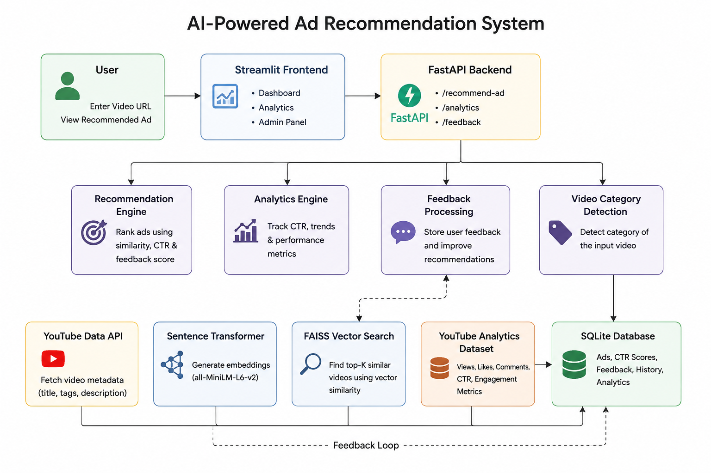

# AdMind

AdMind is a Streamlit dashboard and FastAPI service for matching advertisements to YouTube video titles. The dashboard calls the shared recommendation engine directly; it does not send local HTTP requests to FastAPI.

## Current capabilities and limits

- Recommendation uses the `youtube_analytics.csv` video-title dataset for nearest-neighbour category detection and the SQLite advertisement catalogue for ranking.
- The video category is selected by majority vote among up to five nearest video-title neighbours. It is context only. Ads are ranked by cosine similarity between the video title and the ad name plus description; lexical overlap breaks ties and is the fallback if embeddings fail. The score is raw, not a probability or calibrated confidence.
- Mode, audience, CTR, and global per-ad feedback do not increase relevance ranking. Feedback is not video-scoped, so it cannot safely indicate relevance for a specific video. The starter labeling packet has 12 source titles and 120 candidate pairs; all labels are pending, so no quality metrics or improvement claim are available. See [recommendation evaluation](docs/recommendation-evaluation.md) for how to regenerate and label it.
- Streamlit supports viewing modes `study`, `focus`, `casual`, and `silent`; audience values are `student`, `developer`, `gamer`, `professional`, and `casual`.
- A descriptive YouTube title is required for recommendation. The dashboard accepts an optional title override when metadata is unavailable or needs correction; the video ID is never treated as content. The embedding model is loaded on the first recommendation request, not at app startup. If FAISS is unavailable, vector search uses a NumPy fallback; semantic embedding inference still requires the model and its dependencies.
- Admin is a view-only catalogue page. It is protected by a password hash in the Streamlit session. There are no administrative FastAPI routes.
- Analytics are aggregate counts by ad, not a time series. An impression means a recommendation result was displayed. Feedback is stored separately. A click is accepted only when linked to an impression for the same request; the app currently has no destination-click control because the catalogue has no destination URL field.

## Install and launch

Run commands from the repository root. Python 3.14 is the currently verified runtime; other Python versions are not claimed as supported until CI validates them.

```powershell
python -m venv .venv
.venv\Scripts\Activate.ps1
python -m pip install -r requirements.txt
streamlit run frontend/app.py --server.address 127.0.0.1
```

For a reproducible install on Linux x86_64 with Python 3.14, use the generated hash-locked set:

```sh
python -m pip install --require-hashes -r requirements-linux-py314.txt
```

The lock includes application and CI security tools. Regenerate it from `requirements-linux-py314.in` with the pinned `pip-tools` version recorded in the audit process, then verify installation and tests on Linux before release. The unpinned `requirements.txt` is for local development only.

Start the API separately when needed:

```powershell
python -m uvicorn backend.api:app --host 127.0.0.1 --port 8000
```

The API provides `/`, `/health`, and rate-limited `POST /recommend-ad` (10 requests per minute per IP). Streamlit currently calls the engine directly. The API does not provide authentication for recommendation requests and should be exposed only in a deployment that supplies its own network controls.

`POST /recommend-ad` accepts a 1–500 character `title`, a supported `mode`, and optional `user_type` (default `casual`). The response includes `ad_name`, detected `video_type`, raw `relevance_score`, `relevance_basis`, `ranking_score`, the signals used in `explanation`, and mode-conflict fields. It does not return a confidence probability.

## Architecture



## Configuration

Copy `.env.example` to `.env` in the repository root when configuration is needed:

```dotenv
YOUTUBE_API_KEY=
ADMIN_PASSWORD_HASH=
# DB_NAME=admind.db
```

`YOUTUBE_API_KEY` is optional. `ADMIN_PASSWORD_HASH` is required for admin login; if absent, login fails closed while dashboard and API imports continue to work. The accepted format is `pbkdf2_sha256$iterations$salt_hex$digest_hex`. Generate one without storing the password in source control:

```powershell
python -c 'import hashlib,secrets,getpass; p=getpass.getpass(); s=secrets.token_bytes(16); n=600000; print("pbkdf2_sha256$"+str(n)+"$"+s.hex()+"$"+hashlib.pbkdf2_hmac("sha256",p.encode(),s,n).hex())'
```

Set the printed value as `ADMIN_PASSWORD_HASH` in `.env`. `DB_NAME` defaults to `admind.db` in the repository root. Relative configured paths are also resolved from the repository root. The database is initialized additively; the old aggregate `analytics` table and history rows are retained.

## Datasets

Datasets live under `backend/datasets/`:

- `ads_dataset.csv`: `ad_name`, `description`, `category`, and comma-separated `mode` values. Rows seed the SQLite `ads` table with `INSERT OR IGNORE`.
- `youtube_analytics.csv`: tab-separated data. The recommendation path uses `title` and `category_id`; `backend/services/dataset_service.py` normalizes headers and retains analytics columns when present.
- `videos_dataset.csv`: a separate title/mode/category CSV currently not used by the recommendation path.

The code verifies the exact YouTube category IDs it knows in `backend/services/category_map.py`; unknown IDs become `general`. Advertisement categories are not silently rewritten to YouTube category names. The title and description embedding similarities provide the cross-taxonomy comparison.

## Ranking and analytics definitions

The current relevance ranker compares the video title with each ad name plus its description using cosine similarity. Lexical overlap breaks cosine ties and is used when embeddings fail. Ads with empty descriptions and duplicate offerings are skipped. Video category is explanatory context and does not affect relevance order. Mode, audience, CTR, and feedback are not ranking signals. The raw similarity is not a calibrated probability. See the evaluation guide for the reproducible previous content-scoring baseline and how to label candidates before drawing quality conclusions.

Aggregate CTR is `clicks / impressions`; when impressions are zero it is zero. A feedback action never creates a click. Event records use unique event IDs and a unique request/ad/event-type constraint so repeated writes for the same logical event do not increment aggregates twice. Existing aggregate counts predate event storage and are preserved in the `analytics` table, but the dashboard and ranking ignore them because old click totals may include feedback and cannot be reconstructed as valid events.

## Database and data preservation

SQLite tables are created by `backend.database.init_db()`, which runs at API startup and Streamlit startup. The migration adds `history.ad_category`, `history.session_id`, and an `analytics_events` table plus indexes. Existing history and aggregate analytics are left in place. Newly recorded history stores video category and selected ad category in separate columns. Diversity uses only ad categories for the current session; old rows without those values do not affect the penalty.

Production-mode startup requires an explicitly provisioned database outside the source tree and does not seed catalogue rows. See [deployment preparation](docs/deployment.md), the [operations runbook](docs/operations-runbook.md), and the [privacy lifecycle](docs/privacy-and-data-lifecycle.md) for single-host deployment, backup/restore, retention, and owner decisions. The SQLite backup tool uses SQLite's online backup API and refuses to overwrite output files.

## Tests

Run the standard-library test suite from the repository root:

```powershell
python -m unittest discover -s tests -v
```

The tests use a temporary SQLite database and do not call YouTube. Model inference and the live API are not required by these unit tests.
